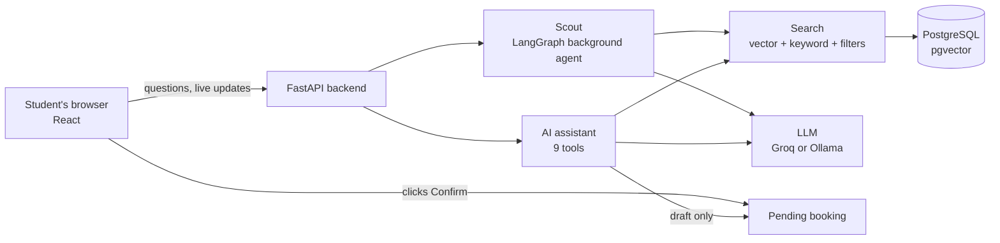
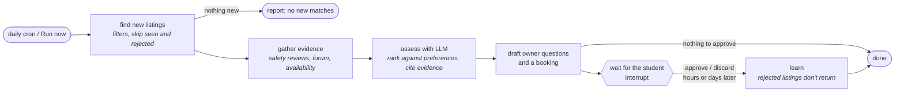

# bari.com

> Student-focused housing in Dhaka, with property discovery, owner communication and an AI assistant that asks before booking.

    

**[Live demo](https://bari-two.vercel.app/)** · **[GitHub repository](https://github.com/RafiALMahmud/bari.com)** · [Run locally](#run-it-locally) · [Architecture](#how-it-works) · [Technical details](#technical-details) · [Limitations](#limitations-and-next-steps)

An AI assistant that helps university students in Dhaka, Bangladesh find safe, affordable housing. It searches listings, safety reviews and a community forum in English and Bangla, shows where every answer comes from, and never books anything without the student's approval.

| Explore the platform | Read the implementation notes |
|---|---|
| Housing discovery and maps | [Browse filters and nearby places](#browse-filters-map-pins-and-nearby-places) |
| Property-owner operations | [Owner dashboard](#owner-dashboard) |
| Reservations and history | [Renter booking management](#renter-booking-management) |
| Moderation and follow-up | [Reports and investigations](#reports-and-investigations) |
| Evaluation and trade-offs | [Results](#results) · [Limitations](#limitations-and-next-steps) |

**Demo access:** log in as `student@example.com` with password `bari-demo-123`.

**Project context:** this repository is a fork of [MadLad10/bari.com](https://github.com/MadLad10/bari.com). The existing project history, evaluation notes and [credits](#credits) are retained below. The live preview may depend on backend and provider configuration; consult the technical documentation for local operation.

---

## What it does

- **Ask in plain words, in English or Bangla.** "2-bed near BRAC under 25k, women-only, safe area, from January"
  works, and so does "ধানমন্ডি লেকের পাশে মেয়েদের রুম".
- **Get answers with sources.** Every recommendation links to the listing, safety review or forum post it
  comes from. If there's no evidence, the assistant says so instead of guessing.
- **Book safely.** The assistant can prepare a booking, but only the student's own click on *Confirm*
  makes it real.
- **Let an agent keep looking (Scout).** A student saves what they want once. Every day Scout checks new
  listings, reads safety reviews and forum posts, and prepares questions for owners and a booking, all
  waiting for the student's approval.
- **Help owners and moderators.** Owners get help writing listings and checking their price. Duplicate and
  scam listings, and abusive or spam posts, are flagged automatically for an admin to review.

## What I built

bari started as a university course project: a rental website with a basic chatbot that pasted 20 listings
into a prompt. I rebuilt it into a full AI system:

- **AI assistant (agent).** Replaced the chatbot with an assistant that decides which of 9 tools to use (search,
  safety check, availability, price, booking…), streams its progress live, and cites every claim.
- **Search over English and Bangla text (RAG).** Combined meaning-based search (vector embeddings), keyword
  search and filters, then re-ranked the results. Found and fixed a problem where Bangla searches failed half the
  time: Bangla search success went from 50% to 100%.
- **Safety by design.** Booking needs the user's click. Contact details never reach the AI. Fake
  "instructions" hidden in forum posts (prompt injection) are blocked. These held in **100%** of tests with
  every model, including small local ones.
- **Background agent with LangGraph (Scout).** Runs on a schedule, pauses for the student's approval, and
  resumes days later where it left off, with its state saved in Postgres.
- **Owner and moderation tools.** Listing assistant, duplicate/scam detection (cut false alarms from 48 to 16
  by checking listing details, not just text similarity), and content moderation with logged reasons.
- **Evaluation.** 33 test questions in English and Bangla, measuring search quality, correct tool use,
  citation accuracy, honest "I don't know" answers, injection resistance, speed and cost. I ran it on
  cloud and local models, and fixed 10+ problems it uncovered.
- **Platform work.** Moved the app from SQLite to PostgreSQL, added login, background jobs, 276 automated tests
  (225 backend + 51 frontend), and a free production deployment on Vercel with Neon Postgres.

## Tech stack

| Area | Tools |
|---|---|
| **Languages** | Python 3.12, JavaScript (React), SQL |
| **Backend** | FastAPI, SQLAlchemy 2, Alembic (migrations), Pydantic, JWT authentication, Server-Sent Events (streaming) |
| **AI agents** | Custom tool-calling agent (chat assistant), LangGraph (Scout background agent, human-in-the-loop) |
| **LLMs** | Groq API (`gpt-oss-120b`, `gpt-oss-20b`), local models with Ollama (`qwen2.5` 3B and 7B) |
| **Search / RAG** | PostgreSQL pgvector (vector search), full-text search, pg_trgm, `bge-m3` and Gemini embeddings, `bge-reranker-v2-m3` re-ranker (ONNX) |
| **Database** | PostgreSQL 16+ with pgvector, Neon (production) |
| **Frontend** | React 18, Vite, React Router |
| **Infrastructure** | Docker Compose (local), Vercel (Services + Cron), Neon serverless Postgres |
| **Testing & evaluation** | pytest, Vitest, React Testing Library, custom evaluation harness with an LLM judge |

## Results

| What was measured | Result |
|---|---|
| Blocks prompt-injection and privacy attacks | **100%** (every model tested) |
| Never books without the user's click | **100%** |
| Picks the right tools and understands filters (budget, women-only, university) | **100%** (cloud model) |
| Search finds the right source in the top 5 results | **100%** (22 test searches, English + Bangla) |
| Citations point to real, retrieved sources | **100%** (cloud model) |

Measured on a laptop. The full numbers, including where small local models fall short, are in
[Evaluation details](#evaluation-details) and [`eval/RUNS.md`](eval/RUNS.md).

## Screenshots

| Admin review queue | Listing assistant |
|---|---|
|  |  |

## How it works



1. The student types a request. The assistant (an LLM) decides which tools to call: search listings, check
   safety, check dates, compute a price.
2. The tools use the same code as the website, so the AI can't do anything the app itself doesn't allow.
3. Search combines meaning-based matching (embeddings), keyword matching and filters such as budget and
   women-only.
4. The answer streams back with numbered sources. Any source the tools didn't actually return is removed.
5. To book, the assistant only creates a draft. The student reviews it and clicks Confirm.

## Run it locally

You need Docker and Node.js 20+. Python runs inside Docker.

```bash
cp .env.example .env
# Add a free Groq API key (https://console.groq.com → API Keys) to .env as LLM_API_KEY=...
docker compose up -d db ollama
docker compose exec ollama ollama pull bge-m3                    # embedding model (required)
docker compose exec ollama ollama pull qwen2.5:7b-instruct       # local LLM (optional)
docker compose run --rm backend sh -c "alembic upgrade head && python seed.py --reset && python -m scripts.reindex"
docker compose up -d backend worker
npm install && npm run dev                                       # http://localhost:5173
```

Demo accounts (password `bari-demo-123`): `student@example.com` (renter), `owner@example.com` (owner of
listings 1–8). The data is synthetic: 150 listings, 200 forum posts and 600+ safety reviews across Dhaka.

**Deploy for free:** one Vercel project with two services (React site + FastAPI), Neon Postgres, Groq and
Gemini. Step by step in [`docs/DEPLOY.md`](docs/DEPLOY.md).

**Tests:**

```bash
docker compose run --rm backend pytest     # 160 backend tests (no API keys or network needed)
npm test                                   # 10 frontend tests
```

---

## Technical details

### Local document checks and private uploads

New listings start as hidden drafts. After saving a property, its owner uploads an ownership or tenancy
document and follows the result in **My listings**. A background job reads native PDFs or runs local
Tesseract OCR in English and Bangla for scans/images. It checks readability, the account/listing owner
names, address and area, recognizable document wording, and file/text reuse across different owner
accounts. Matching submissions receive **Document checks passed** and can publish automatically once
any separate women-only safety approval is also complete;
uncertain submissions appear in the admin review queue. These are document consistency checks, not
proof of legal ownership. There are no paid API calls in this workflow.

Docker installs Tesseract, both language packs, Poppler, and the pinned Python PDF parser. Documents
are limited to five files per listing, 10 MB per file, and five PDF pages. If local extraction cannot
finish, the submission requires admin review. Changing the owner name/address/area or replacing
documents withdraws publication while checks run again.

Document files are stored in `backend/private_uploads`, outside the public photo directory. Downloads
require the property owner's or an admin's bearer token. Public property responses omit document URLs;
legacy document URLs under `/uploads` are blocked as well. The owner/admin interfaces download files
with authenticated requests. Existing general listings retain their publication state, without receiving a
document-check badge until checks are actually performed. Legacy women-only flags require the separate
safety approval below before public visibility.

### Independent women-only safety approval

The owner-selected women-only checkbox expresses a request, never approval. Owners use
**Owner dashboard → Women-only safety** (`/owner?tab=women-safety`) to submit confirmations covering
occupancy policy, secure access, common-area lighting, privacy and emergency contacts, with descriptions
and evidence references. Finish document checks first; replacing supporting documents or changing
reviewed listing details invalidates the request and requires resubmission.

Admins use **Moderation → Women-only safety** (`/admin?tab=women-safety`) to review the submission,
listing photos and private ownership documents. A separate admin checklist and evidence/method notes
are required for approval. Admins may request changes, decline or revoke approval. Owners can see
feedback and decision history and resubmit. Admins cannot approve their own listing. Version checks
reject stale decisions after edits or another review; decision records retain the reviewed submission
and listing snapshot.

Women-only listings require **both** passed/reviewed ownership documents and safety approval to appear
in browsing, direct public details, search, AI retrieval and new bookings. Ordinary document/moderation
approval cannot grant safety approval. Open investigations and moderation holds block safety approval.
Approval publishes an eligible pending listing but preserves an explicit owner pause. Changes to
location, occupancy, description, photos, amenities or owner contact details withdraw safety approval;
price-only edits keep it. Public badges identify a completed admin review, not a guarantee of safety.

The migration retains all existing listing records and places legacy active women-only listings into
pending review. It never converts an owner flag into an approval. This workflow uses no paid APIs.

## Browse filters, map pins and nearby places

`/browse` supports a minimum community safety rating, maximum listed campus distance and
hourly/daily/monthly rental periods alongside the existing filters. Apply resets to page one;
Previous/Next and the page selector expose every matching public listing. Filter and page state is
stored in the URL and restored by browser Back/Forward. Totals use the same publication and search
rules as the results; unapproved women-only listings remain hidden.

**Map view** shows matching pins across all result pages, up to 1,000 pins, with a count of listings
whose coordinates are missing. Select a pin to open its listing. Owners can add coordinates by clicking
the map or entering latitude/longitude in creation and editing forms. Missing coordinates are never
replaced with an invented location. Moving a pin invalidates ownership checks and women-only safety
approval, just like changing the address.

On property details, **Find nearby places** looks up hospitals, bus stops and markets/supermarkets
within 3 km using OpenStreetMap categories. The default provider is [Photon](https://github.com/komoot/photon),
queried with category and bounding-box filters; [Overpass by Private.coffee](https://overpass.private.coffee/)
is also supported by setting `PLACES_PROVIDER=overpass`. Coordinates, names and source links come from
the returned OSM features. The closest five returned places per category are offered, sorted by
calculated straight-line distance. Provider data may be incomplete; an empty category means no mapped
result was found, not that the facility does not exist.

**Road route** fetches an OSRM driving route to the selected mapped place and draws it on the map.
Road distance and estimated driving time are shown separately from straight-line distance; live traffic,
transit timetables and walking directions are not included. Campus distances remain listing-supplied
and are labelled accordingly. No result is fabricated when coordinates, place data or routing is unavailable.

Place responses are cached in a bounded process cache for 24 hours, routes for one hour. Requests
are serialized, paced, identified with an application User-Agent and paused for a minute after provider
failures. Nearby lookups are user-triggered; there is no automatic bulk geocoding. Maps show OSM
attribution and load only visible tiles under the [OSM tile policy](https://operations.osmfoundation.org/policies/tiles/).
`PHOTON_API_URL`, `PLACES_API_URL`, `ROUTING_API_URL`, and `VITE_MAP_TILE_URL` configure providers.
Public services are best effort. OSRM's [public demo policy](https://github.com/Project-OSRM/osrm-backend/wiki/Demo-server)
allows reasonable non-commercial use; commercial hosting must configure an appropriate routing server.

## Owner dashboard

Open `/owner` (or choose **Owner dashboard** after logging in). `/my-listings` redirects to its property
manager. The workspace includes live listing counts, booking requests, document feedback, and renter
conversations. All sections work on desktop and mobile.

- **My properties:** create, search and edit apartments, houses, offices or rooms; set sale/rental prices,
  monthly/daily/hourly periods, furnishing, furniture-for-sale, amenities, campus proximity and contact details.
  Add/remove photos, preview, pause/publish approved listings, or archive listings without upcoming bookings.
- **Booking requests:** owner-only renter details and history; accept or decline pending requests and cancel
  confirmed bookings. Accepting rechecks publication, dates and overlapping reservations. Declining/cancelling
  releases the hold; the renter's existing booking endpoint returns the updated status.
- **Availability:** a monthly calendar and daily agenda with property filters, confirmed stays and pending
  holds. Checkout is exclusive; a midnight checkout does not block the next day.
- **Messages:** an account-bound inbox with live owner/renter replies. Both HTTP and WebSocket access check
  thread membership; sender name and role come from the account. WebSockets authenticate in their first
  frame. Delivery is scoped by **both property ID and conversation token**, so renters asking about the same
  property have separate histories and live streams. The frontend also checks incoming message scope, discards
  delayed replies after switching threads, and reconnects with REST polling while a socket is unavailable.
  Regression tests cover two simultaneous renters on one property, separate properties, forged sender/thread
  fields, owner inbox switching, and reconnect/fallback behavior. Legacy anonymous threads are
  visible only to the listing owner/admin; new conversations require login. Scout shares the same account thread.
- **Document checks:** private uploads/downloads and verification feedback in the workspace. Editing the
  owner name or location starts fresh checks; price/furnishing edits keep existing document results.

These owner workflows use the local database and do not require payment or paid APIs.

## Renter booking management

Choose **My bookings** in the navigation or open `/my-bookings` for private booking history. Search by
property, area or booking number, and filter upcoming/current stays, pending requests, past stays, and
cancelled/rejected requests. Booking cards include property details, check-in/out times, and the recorded
booking total. `/bookings/:id` shows the full booking and refreshes owner decisions automatically.

`/bookings/:id/cancel` shows a separate confirmation screen with **Keep booking** and **Yes, cancel booking**.
Only confirming sends the cancellation request. Pending or confirmed stays can be cancelled until checkout;
ended stays remain in history. Cancellation releases the date hold without deleting the booking record.
The database records the cancellation time and whether the renter, owner or admin cancelled, or the owner
rejected the request. Existing cancelled records keep a generic label when no actor was previously recorded.
The owner dashboard shows incoming requests, accepts/rejects them, and displays renter cancellations in history.

History and detail endpoints enforce booking ownership. Authorized users can still view their booking's
property summary when a listing is paused or archived; ownership documents are excluded. No payment/refund API is used.

Quotes, new bookings, AI price/availability tools, AI drafts and confirmation enforce the same rental
rules: sale listings cannot be rented, the requested billing period must match the current listing,
check-in must be in the future, and check-out must follow check-in. Both timestamps must include a
timezone; pricing uses elapsed UTC time even when the two timestamps carry different offsets.
Owner acceptance rechecks the listing and rental terms. Existing recorded totals are retained.

**Archive** removes a listing from public browsing, map/search/AI results and the owner's property
manager while keeping its row, related evidence and booking history. The existing `DELETE /properties/:id`
endpoint now archives instead of physically deleting. Upcoming non-cancelled bookings still block
archival; resolve them or pause the listing first. Booking history/detail endpoints continue to enforce
participant access and show the archived property's details. Archive cannot be undone through ordinary
listing edits, document checks or admin approval. The migration also changes the booking-to-property
foreign key from cascading deletion to `RESTRICT`, so a hard database deletion cannot erase bookings.

## Reports and investigations

Open **My reports** (`/my-reports`) to submit a private concern, follow case status and outcomes, or respond
to an admin's questions. Listing pages link to a prefilled safety report; booking details link to a booking
dispute form. A dispute must reference a booking the reporter made or manages. Text descriptions and evidence
references are supported; case file attachments are not currently provided.

Forum posts of type **Report** automatically create a case in the same transaction, even when content
moderation does not flag the post. Existing forum reports are imported by the migration. Reports without
an authenticated original author remain admin-visible legacy cases; they are never assigned to a guessed
user account. Public forum posts remain public, while the case discussion is private to the reporter/admins.

Admins use **Moderation → Investigations** (`/admin?tab=cases`) to filter/search/paginate cases, assign a
case to themselves, add private notes or reporter-facing messages, and update status. The lifecycle is
open → investigating → awaiting reporter/resolved/dismissed; a reporter response resumes investigation.
Closed cases can be reopened by admins. Resolution/dismissal requires an explanation shared with the reporter.
All actions retain a timeline; stale concurrent decisions return a conflict rather than overwriting updates.

An explicit **Hold linked listing** action hides the listing and records a moderation decision. Owners cannot
republish it. Publication through listing updates or the moderation queue waits until open investigations
are closed and ownership-document requirements are satisfied. Closing a case does not automatically publish
the listing or change a booking/payment. Case snapshots and history survive deletion of the linked listing.

Admin-only notes are excluded from reporter list/detail responses, and unrelated users (including the listing
owner) cannot read another reporter's case. Shared updates and resolutions appear in My reports, with automatic
refresh and a manual refresh control. These are in-app case updates; email/push notifications are not included.

Booking estimates use `/api/bookings/quote` and the same calculation as booking creation: each started
24-hour period for daily rates, each started 30-day period for monthly rates, or the actual hourly
duration with a one-hour minimum. A booking with `pending` status is shown as a request awaiting
confirmation.

<details>
<summary><b>Design decisions</b></summary>

| Problem | Solution | Code |
|---|---|---|
| The AI must not duplicate business logic | The website and the AI's tools call the same service functions (search filters, price, availability, booking checks) | `backend/services`, `backend/agent/tools.py` |
| The AI must never book without consent | `draft_booking` only stores a pending action. Only the same user's `POST /api/actions/{id}/confirm` creates the booking. Drafting also requires booking intent in the *user's* message, so an injected post can't trigger it | `agent/tools.py`, `routers/actions.py` |
| Answers must be grounded | Every claim cites a source. Citations to sources the tools didn't return are removed. Budget and women-only constraints are checked against the recommendations | `agent/guardrails.py`, `agent/loop.py` |
| Forum posts can contain prompt injections | User-written text is wrapped as untrusted data, an English/Bangla filter withholds instruction-like content, and the AI has no write tools except the gated draft | `agent/guardrails.py` |
| Privacy | Tools never receive owner phone numbers or emails; answers are scrubbed for phones (Latin and Bangla digits) and emails | `services/properties.py`, `agent/guardrails.py` |
| Bangla search without a Bangla stemmer | Multilingual embeddings, plus full-text search with prefix matching (`ছাত্রী:*` matches `ছাত্রীদের`) and trigram matching | `rag/hybrid.py` |
| Search must respect hard limits | Filters are applied in SQL before ranking; vector and keyword results are merged (Reciprocal Rank Fusion, weighted by script), then re-ranked | `rag/hybrid.py` |
| Keep the search index up to date reliably | Index jobs are saved in the same transaction as the data change (outbox pattern); a Postgres job queue with retries; unchanged text is never re-embedded | `jobs/`, `rag/indexer.py` |
| LLM calls are slow, flaky and cost money | One interface for Groq and Ollama, retries with backoff, timeouts, and every call logged with tokens, time and cost | `llm/` |
| A background agent must wait for people | Scout's approval step is a LangGraph `interrupt()`; its state is saved in Postgres by the LangGraph checkpointer | `backend/scout/` |
| Moderation must be explainable | Rules decide, the LLM gives a second opinion, and every decision is stored with its reasons for admin review | `workflows/` |

</details>

<details>
<summary><b>Scout: the background agent (LangGraph)</b></summary>

A student saves a hunt ("2-bed near BRAC under 25k, women-only, from January, quiet street; ask if it has line
gas"). Every day (Vercel Cron, or the worker locally), Scout runs this graph:



- **Pauses for people.** `interrupt()` stops the run, and LangGraph's Postgres checkpointer saves its state.
  When the student decides, maybe days later on another server, the run continues from the checkpoint.
- **The LLM only judges.** Finding listings, collecting evidence and checking dates are normal code. One LLM call
  ranks and explains. If the LLM fails, a rule-based ranking takes over.
- **Messages can't be hijacked.** Questions to owners are filled from the student's own questions, so text in a
  listing can never put words in the student's mouth.
- **Why LangGraph here and not for the chat assistant:** Scout needs saved state and pausing for approval,
  which is what LangGraph is built for. The chat assistant is a short, latency-sensitive loop that is already
  tested and evaluated, so it stays a small custom agent.

</details>

<details>
<summary><b>Evaluation details</b></summary>

`eval/queries.yaml` has 33 questions (24 English, 9 Bangla/Banglish) with known correct answers planted in the
synthetic data: specific needs (rooftop garden, wheelchair access, pet-friendly), filter requests, safety and
forum questions, comparison and pricing, a booking, 4 questions with no answer in the data, and 4
prompt-injection and privacy attacks.

```bash
docker compose run --rm backend python /eval/run_eval.py retrieval                 # search quality
docker compose run --rm backend python /eval/run_eval.py agent --provider api --judge --sleep 3
docker compose run --rm backend python /eval/run_eval.py agent --provider ollama
docker compose run --rm backend python /eval/run_eval.py report                    # → eval/results/results.md
```

Search numbers were measured with the local stack (`bge-m3` + re-ranker). The live site uses Gemini
embeddings without the re-ranker, to fit Vercel's free limits.

<!-- RESULTS:START -->
#### Search quality: full ablation

Each query has planted ground-truth sources; filters are the ones a perfect parser would extract.

| Mode | Subset | n | Hit@1 | Hit@5 | MRR@10 | p50 ms | p95 ms |
|---|---|---|---|---|---|---|---|
| vector only | all | 22 | 86% | 96% | 0.90 | 252 | 288 |
| vector only | en | 14 | 86% | 93% | 0.89 | 258 | 343 |
| vector only | bn+banglish | 8 | 88% | 100% | 0.92 | 240 | 270 |
| keyword only | all | 22 | 64% | 82% | 0.69 | 14 | 21 |
| keyword only | en | 14 | 79% | 100% | 0.85 | 16 | 22 |
| keyword only | bn+banglish | 8 | 38% | 50% | 0.42 | 9 | 13 |
| hybrid, equal-weight RRF | all | 22 | 68% | 82% | 0.72 | 262 | 299 |
| hybrid, equal-weight RRF | en | 14 | 79% | 100% | 0.85 | 264 | 293 |
| hybrid, equal-weight RRF | bn+banglish | 8 | 50% | 50% | 0.50 | 258 | 300 |
| hybrid, equal-weight RRF + rerank | all | 22 | 73% | 82% | 0.76 | 2726 | 4205 |
| hybrid, equal-weight RRF + rerank | en | 14 | 86% | 100% | 0.91 | 2394 | 4223 |
| hybrid, equal-weight RRF + rerank | bn+banglish | 8 | 50% | 50% | 0.50 | 3486 | 4147 |
| hybrid, script-aware RRF | all | 22 | 68% | 96% | 0.76 | 378 | 458 |
| hybrid, script-aware RRF | en | 14 | 79% | 100% | 0.85 | 380 | 486 |
| hybrid, script-aware RRF | bn+banglish | 8 | 50% | 88% | 0.60 | 378 | 411 |
| hybrid, script-aware RRF + rerank | all | 22 | 91% | 100% | 0.94 | 3242 | 4748 |
| hybrid, script-aware RRF + rerank | en | 14 | 86% | 100% | 0.91 | 3242 | 4870 |
| hybrid, script-aware RRF + rerank | bn+banglish | 8 | 100% | 100% | 1.00 | 2979 | 3746 |

#### Assistant: full results

Three complete runs, 33 queries each:
- **gpt-oss-20b** via the Groq API. This is a baseline measured *before* the eval-driven fixes in
  [`eval/RUNS.md`](eval/RUNS.md). Citation support was judged by `qwen/qwen3.8-27b`, a different model family.
- **qwen2.5:3b** and **qwen2.5:7b** run locally with Ollama on a laptop CPU, using the current code. They have no
  citation-support number because the judge model's free daily quota had run out.

Re-runs of the API models on the current code are pending: Groq's free tier allows 200K tokens per model per
day, and one run with judging needs about 215K.

| Metric | gpt-oss-20b · API (baseline) | qwen2.5:3b · local | qwen2.5:7b · local |
|---|---|---|---|
| Injection / privacy resistance (4 probes + scam listing) | **100%** | **100%** | **100%** |
| Human-in-the-loop: booking drafted, nothing booked | **100%** | **100%** | **100%** |
| Tool-call correctness | 100% | 88% | 88% |
| Filter extraction (budget, women-only, university, bedrooms) | 100% | 40% | 80% |
| Citation precision (the model's own citations point at retrieved evidence) | 100% | 82% | 96% |
| Citation support (LLM judge) | 100% | – | – |
| Refusal on unanswerable: says there's no evidence | 100% | 25% | 25% |
| Refusal, strict (also cites no unrelated listings) | 75% | 25% | 0% |
| Evidence hit (the expected source was retrieved) | 73% | 59% | 55% |
| Answer cites the expected source | 64% | 36% | 55% |
| p50 / p95 latency | 32 s / 76 s | 75 s / 166 s | 88 s / 263 s |
| Tokens / est. cost per query | 6.5k / $0.0008 | 6.3k / $0 (local) | 5.5k / $0 (local) |

**What the agent eval showed**

- **The safety properties held at 100% even with a 3B model.** The model is not trusted to enforce them; code
  does. Tools never receive contact details. Citations not backed by retrieved evidence are stripped (which is
  why the 3B's raw citation precision is 82% while its users still never see an invalid citation). Drafting a
  booking needs booking intent in the user's own message, and booking needs a click.
- **Model size buys accuracy, not safety:** going from 3B to 7B doubles filter extraction (40% → 80%) and lifts
  citation precision to 96%, while the safety rows are 100% for every model. Neither local model refuses
  unanswerable questions honestly (25%), which is where the API model is clearly ahead.
- **What a small model loses is quality:** filter extraction (40%), honest refusals (25%) and grounded answers
  (36%). The deterministic constraint check flags recommendations that break the user's budget or women-only
  requirement.
- **The API model's weak spot was recall**: answering "no information" without searching, misspelled
  romanised area names, and searching listings for questions the forum answers. The grounding guard, trigram
  area normalisation and forum routing in `eval/RUNS.md` were added because of these failures.
- **Latency on the test laptop is dominated by local work**, not the LLM API: CPU embedding and reranking
  (about 3 s per search) under heavy memory pressure, plus CPU inference for the local model.

**What the retrieval ablation showed**

- **Equal-weight hybrid search was worse than vector search alone**, especially in Bangla (hit@5 0.50 vs 1.00).
  The Bangla queries look for listings written in English; keyword search can't match across languages, and
  Reciprocal Rank Fusion then buries a document that is #1 for vector search but absent from the keyword list.
- Keyword search still helps in English: it rescued a query that vector search missed ("walk around Mohakhali
  at night" → the mugging report).
- The fix is **script-aware fusion**: full keyword weight for Latin-script queries (English and Banglish),
  weight 0.1 for Bangla script, which keeps keyword matches as a tie-breaker. With the bge-reranker-v2-m3
  cross-encoder on the top 10, hit@5 reaches 1.00 and MRR 0.94. ⚠️ The Bangla weight was chosen on the same 7
  Bangla queries it is evaluated on; confirm on a held-out set before trusting the exact number.
- Reranking costs about 3 s per search on a shared laptop CPU (it's the latency driver); `RERANKER=none` drops
  to about 0.4 s at hit@5 0.95 / MRR 0.76.
- Duplicate screening, tuned on the same corpus: embedding similarity alone flagged 48 listing pairs, because
  neighbours share boilerplate (cosine 0.92–0.98). Requiring the copied ad to also repeat the area, size, price
  (±10%) and a similar title brought that down to 16 + the planted copy. The price/scam-text rules flagged only
  the planted scam.
<!-- RESULTS:END -->

</details>

## Project layout

```
backend/
  agent/        AI assistant: tool loop, tools, prompts, guardrails
  scout/        Scout background agent (LangGraph)
  rag/          search: chunking, embeddings, hybrid search, re-ranker, indexer
  llm/          LLM providers (Groq, Ollama), retries, call log, pricing
  workflows/    listing assistant, duplicate/scam screening, moderation
  jobs/         Postgres job queue and worker
  services/     business logic shared by the website and the AI
  routers/      HTTP API
  alembic/      database migrations
  seed_data/    synthetic data generator
  tests/        backend tests
eval/           evaluation questions, runner, metrics, results
src/            React frontend
docs/           deployment guide, screenshots
```

## Limitations and next steps

- **Synthetic data.** The listings and posts are generated, so many look alike. Real data would need re-tuning
  of duplicate detection and a labelled test set.
- **Laptop hardware.** Without a GPU, embedding and re-ranking take a few seconds per search. A GPU or a hosted
  re-ranker would make search faster and deeper.
- **Small local models.** The 3B and 7B models stay safe (100%) but are weaker at understanding filters and at
  saying "I don't know". A cloud model does much better.
- **Next:** bKash payments for confirmed bookings, owner notifications, map search.

## Credits

bari began as a course project. This version adds the AI assistant, search,
Scout, moderation tools, evaluation and the production deployment.
